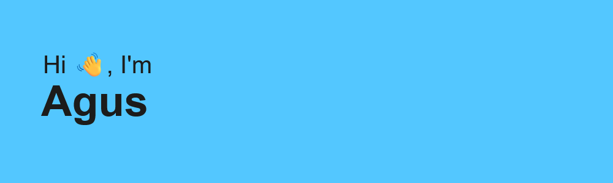
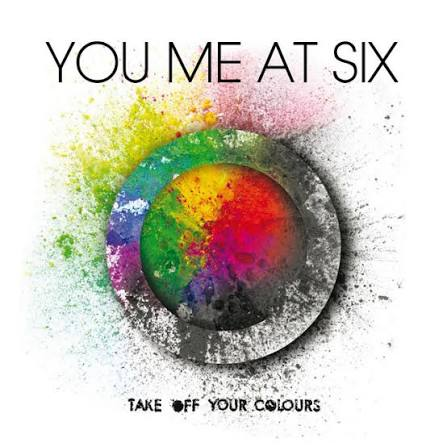

  

  

### 🚀 Creative Developer & UI/UX Designer

Welcome to my GitHub profile! I blend design and code to create engaging digital experiences.

---

### 🎵 Now Playing Widget

  <table>
    <tr>
      <td align="center" width="110">
        
      </td>
      <td width="280" valign="middle">
        <b>Save It For The Bedroom</b> 
        <b>You Me At Six</b> — <i>Take Off Your Colours</i>
          
        <code>⏮️ &nbsp;&nbsp; ⏸️ &nbsp;&nbsp; ⏭️</code>
      </td>
    </tr>
  </table>

> 🎵 *Music is a core part of my creative workflow — whether designing UI concepts or coding frontend applications, there is always a soundtrack playing in the background.*

---

### 👤 About Me

- 🎨 **Design & Development:** Passionate about UI/UX design, visual aesthetics, and frontend web development.
- 🔭 **Currently working on:** Exciting design systems and web projects.
- 🌱 **Currently learning:** Modern frontend frameworks & creative design trends.
- 👯 **Looking to collaborate on:** Creative projects, UI/UX designs, and open-source applications.
- 💬 **Ask me about:** Graphic design, UI design, web development, and digital media.
- 📫 **How to reach me:** [agussv360@gmail.com](mailto:agussv360@gmail.com)

---

### 🎨 Featured Work & Projects

| Project | Focus | Link |
| :--- | :--- | :--- |
| **Behance Portfolio** | UI/UX Case Studies & Visual Designs | [View Case Studies ➔](https://www.behance.net/starboyagus) |
| **GitHub Repositories** | Web Applications & Frontend Code | [View Repositories ➔](https://github.com/starboyagus?tab=repositories) |

---

### 🌐 Connect with Me

    

---

### 🛠️ Tools & Technologies

#### 🎨 Design & Creative
   

#### 💻 Development & Engineering
     
